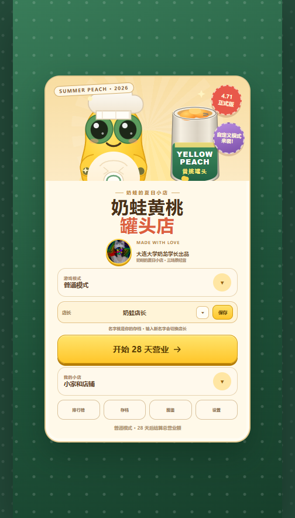
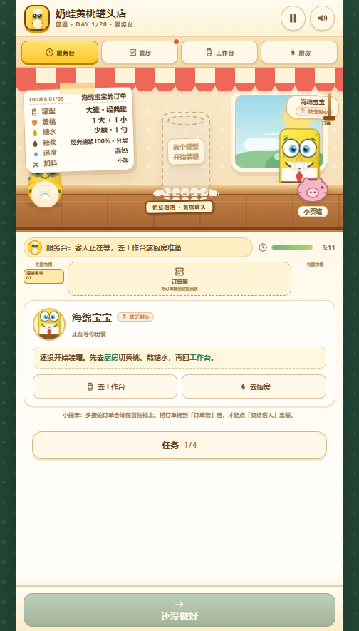
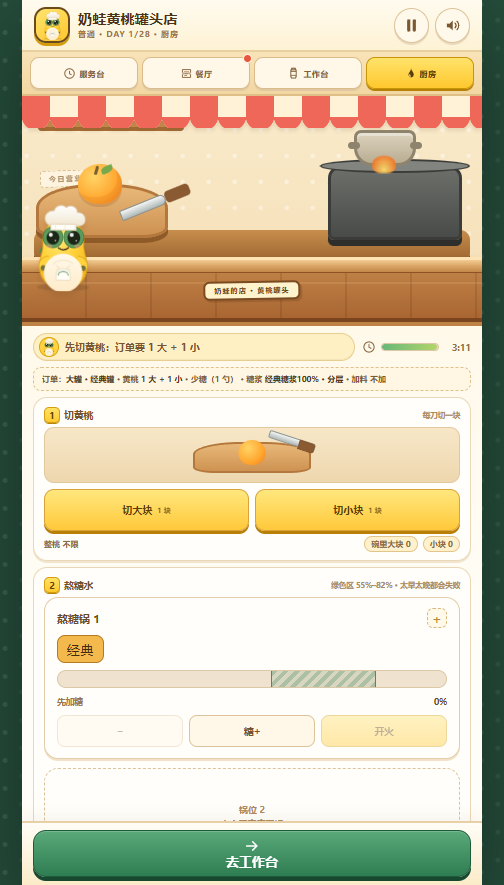
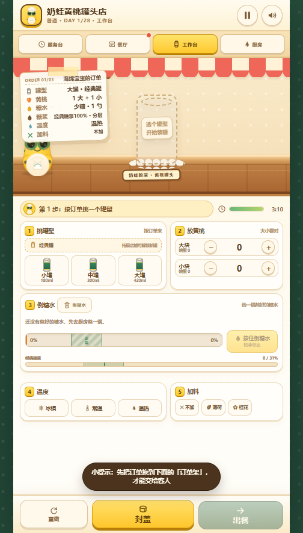
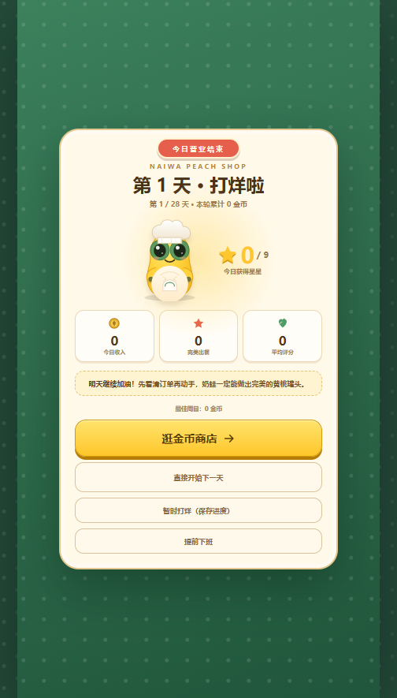
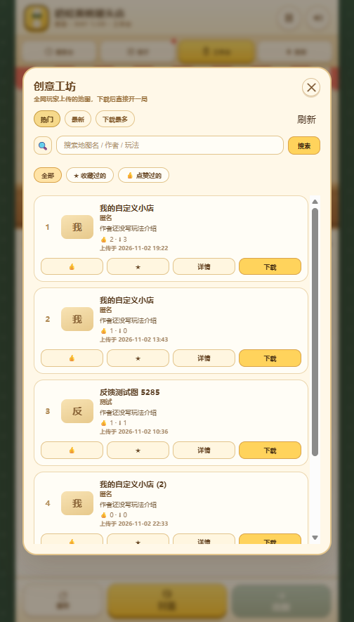

# 奶蛙黄桃罐头店 · 正式版 5.0

一个纯前端（HTML + CSS + JavaScript）的竖屏小店经营游戏：白天接客、切桃、熬糖水、装罐、封盖、出餐，打烊后逛金币商店；除此之外还有肉鸽模式、无尽模式、七天新手教学，以及一个能自己造地图、上传工坊的**自定义模式**。

没有后端、没有框架、没有构建依赖——游戏本体就是一个可以直接双击打开的 HTML 文件。**现在也有安卓安装包了。**

## 立刻试玩

| 入口 | 地址 |
| --- | --- |
| 主站（GitHub Pages，推荐） | <https://ostonefisho.github.io/naiwa-peach-shop/> |
| 安卓安装包（GitHub Release） | <https://github.com/OStonefishO/naiwa-peach-shop/releases/latest> |
| 备用镜像（html.cafe 单文件） | <https://html.cafe/x8b917dbd> |
| 仓库 | <https://github.com/OStonefishO/naiwa-peach-shop> |

手机微信 / QQ / 浏览器直接点开即可，进度存在本机 localStorage 里；也可以在设置里填同一店长名 + 存档密码，用 Supabase 跨设备同步。

## 截图

| 标题页 | 服务台 |
| --- | --- |
|  |  |

| 厨房 · 切桃与熬糖 | 工作台 · 装罐与封盖 |
| --- | --- |
|  |  |

| 每日结算 | 创意工坊 |
| --- | --- |
|  |  |

## 四种模式

| 模式 | 说明 |
| --- | --- |
| **普通模式** | 28 天固定营业，按当天的营业额结算，适合先熟悉流程。 |
| **无尽模式** | 七天一个周期，周目标逐周递增，活得越久排名越高。 |
| **肉鸽模式** | 每周一个金币指标，局内可抽辣虾（增益 / 诅咒）、逛肉鸽夜市、遇到随机事件与 BOSS 日；金币只在本局使用。 |
| **新手模式** | 七天手把手教学：出餐流程、客人性格、插队、复杂订单、精英日、混合糖浆，通关后引导去普通模式。 |

另外还有一个 **自定义模式**：自己定客人、锅数、订单复杂度、评分权重、周任务，保存成地图，既能本地开玩，也能上传到「创意工坊」给全网玩家下载。

## 玩法核心

- **订单票**：罐型 / 黄桃数量与大小 / 糖水糖度 / 糖浆种类与比例 / 温度 / 加料，全部照单抓药。
- **糖水**：一锅最多 6 种糖浆，每种独立调节比例（1% 精度），可以「一起熬」也可以「分开熬再分层」。
- **评分**：罐型、罐子、黄桃、糖浆种类、糖浆比例、熬糖火候、倒糖量、搅拌、温度、加料、出餐速度，共 11 项；自定义模式可以逐项开关并按权重加权。
- **客人性格**：大方、苛刻、斤斤计较、有耐心、缺乏耐心、易怒、重度抑郁症…… 有的只看死亡之糖，有的会偷小费，有的被插队会翻倍扣分。
- **小费**：基础小费 → 复杂订单加算 → 来财 / 周成长 / 客人倍率等乘算，结算页有完整明细。
- **金币商店**：锅、闹钟、刀具皮肤、糖浆、小料、罐型、家具、服饰、全套皮肤与变体。
- **小费罐**：服务台右下角的猪猪存钱罐，点一下会弹跳并告诉你现在有多少钱。

## 自定义模式 & 创意工坊

- **自定义中心**：创作新地图 / 我的地图 / 创意工坊三个入口。
- **编辑器**：客人数量与权重、出现的客人名单、耐心、经营周数与每周天数、精英日 / BOSS 日、锅位 1–20、糖浆份数、是否切桃 / 搅拌 / 温度 / 小料、复杂订单概率与区间、周金币目标与周任务（14 种词条、5 套模板）、每一项评分权重、熬糖 / 倒糖速度、自定义商店价格与成长倍率。
- **地图码**：一键复制 / 导入，方便分享。
- **创意工坊**：上传（1:1 封面裁切、简介、主要玩法）、下载、点赞、收藏、搜索、分页、按热门 / 最新 / 下载最多排序，自己上传的地图可以「更新地图 / 下架地图」。
- 工坊后端是 Supabase（表结构与 RLS 策略见 `tools/workshop-supabase.sql`）。

## 其他系统

- **更衣室**：全套皮肤（经典 / 捧腹 / 小奶蛙 / 奶霸 / 奶蛋）、皮肤变体（老祖 / 奶粉 / 学习通）、帽子、眼镜、上衣；非经典皮肤不能穿小装饰，但可以换「变体」。
- **小家**：家具摆放与拖动，房间可以左右浏览。
- **图鉴**：辣虾、客人、道具收集进度。
- **排行榜**：无尽 / 肉鸽双榜，本机榜 + 可选的全网榜。
- **存档**：多店长档案、本机存档码、Supabase 云存档（店长名 + 4–8 位存档密码）。
- **设置**：主音量 / 音乐 / 闹钟 / 捧腹大笑音量，开发者模式与开发者物品栏。

## 安卓版

`android/` 是一个不依赖 Gradle 的 WebView 壳工程，把同一份 `wechat-qq/index.html` 装进 APK：

- 包名 `com.naiwa.peachshop`，minSdk 24（Android 7.0），竖屏锁定、沉浸式全屏；
- 页面从内置的 `127.0.0.1` 本地服务器加载（不是 `file://`），所以存档、`fetch` 排行榜、工坊上传都正常；
- 开屏动画、奶油色退出确认卡片、返回键二次确认；
- 装好后在「设置 → 检查更新」里可以比对官网版本，有新版本会直接给出下载入口。

安装包由本机 `node android/build-apk.cjs` 签名产出，落到 `dist/naiwa-peach-shop-<版本>.apk`；
推送到 `main` 后 `release-apk.yml` 会把它挂到对应的 GitHub Release 上。详见 [`android/README.md`](android/README.md)。

## 技术栈

- 原生 HTML + CSS + JavaScript，无框架、无打包器、无 npm 依赖。
- 单文件发布：`src/build.cjs` 把 JS、CSS、图片、音频全部内联成一个 `wechat-qq/index.html`。
- 音频用 WebAudio / `<audio>` 双通道，带解锁与看守逻辑，适配手机浏览器与微信。
- 静态托管：GitHub Pages（Actions 自动部署）+ html.cafe 镜像。
- 可选后端：Supabase（工坊地图、全网排行榜、云存档）。

## 目录结构

```
src/
  v2.html           页面骨架 + 全部 CSS（<title> 里的「正式版 X.Y」是版本号唯一来源）
  game.v2.js        全部游戏逻辑（约 9800 行）
  build.cjs         构建脚本：内联成单文件 + 生成 version.json
  char-assets/      奶蛙皮肤与变体立绘
  rogue-assets/     肉鸽 BOSS 立绘
android/            安卓壳工程（手工 aapt2/javac/d8 构建，见 android/README.md）
dist/               已签名的安卓安装包（随 main 提交，供 CI 发版）
tools/
  publish-htmlcafe.cjs      html.cafe 镜像发布
  workshop-supabase.sql     工坊建表 / RLS / RPC
  leaderboard-supabase.sql  排行榜建表
  leaderboard-worker.js     Cloudflare Worker 版排行榜（可选）
wechat-qq/index.html  构建产物（真正发布的单文件）
wechat-qq/version.json 当前版本信息（「检查更新」读取它）
docs/shots/           README 截图
```

## 本地开发

```bash
# 起一个静态服务（任选其一）
python -m http.server 8791
# 或 npx serve .

# 打开带调试出口的源码版本
# http://127.0.0.1:8791/src/v2.html?debug=1
# 控制台里的 window.__naiwa 可以改状态、跳场景、开面板
```

## 构建与发布

```bash
node src/build.cjs          # 生成 wechat-qq/index.html + version.json
node android/build-apk.cjs  # 生成 dist/naiwa-peach-shop-<版本>.apk（需要 JDK 17 + Android SDK）
```

推送到 `main` 后 GitHub Actions 会自动发布到 Pages，并把 `dist/` 里的安装包挂到 Release
（`.github/workflows/deploy-pages.yml` + `.github/workflows/release-apk.yml`）；
镜像站用 `node tools/publish-htmlcafe.cjs` 单独同步（需要 `HTMLCAFE_ID` / `HTMLCAFE_KEY` 环境变量）。

> 版本号只需要改 `src/v2.html` 里 `<title>` 的「正式版 X.Y」，页面显示、`version.json`、
> APK 的 versionCode/versionName、Release 的 tag 全都从这里推导（`versionCode = major*100 + minor`）。

## 更新日志（节选）

- **5.0** 安卓版上架（Release 提供安装包）；设置里新增「检查更新」，可比对官网版本
- **4.71** 工坊排序按钮高亮、地图显示上传时间
- **4.70** 小家改回传统滚动条
- **4.69** 肉鸽小费罐读取本局金币；小家可左右浏览
- **4.68** 周任务数字框可直接输入
- **4.67** 暂停「提前下班」重复弹窗修复
- **4.66** 小费罐位置下移
- **4.65** 小费罐回归、局内商店隐藏皮肤页、刀皮肤生效
- **4.64** 暂停面板层级修正、结算页去掉经典底图
- **4.63** 暂停键在对局内常驻
- **4.61 / 4.62** 新皮肤与大笑音效、编辑器数字输入、暂停面板改版
- **4.60** 商店改版 + 皮肤页（全套皮肤 / 变体 / 帽子 / 眼镜 / 上衣）
- **4.58** 皮肤变体槽、猪猪存钱罐动画、暂停两个按钮
- **4.57** 工坊分页、肉鸽锅位修复、自定义顶栏、首日任务面板

完整更新日志在游戏内「设置 → 更新日志」。

## 说明

- 游戏内美术素材（奶蛙、客人、BOSS）由作者提供并在项目内使用；音乐为项目内音频文件。
- 部分立绘用白底 PNG 抠像后内联，边缘可能有轻微白边，属正常现象。
- 本项目是个人作品，欢迎提 issue 或 PR。

---

**奶蛙的夏日小店 · 大连大学奶龙学长出品**
